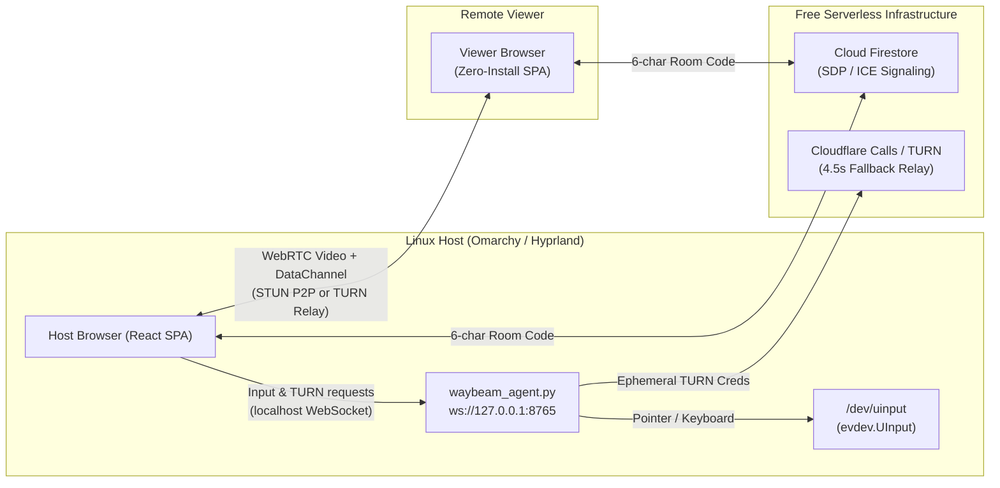

# WayBeam

> **Zero-install browser screen-sharing and host-approved `/dev/uinput` remote-control web app for Linux (Omarchy / Hyprland).**


WayBeam lets you share your Linux Wayland desktop or window to any modern browser over WebRTC with **zero viewer installation**, **zero server hosting costs**, and **strict host-controlled input injection** via Linux `/dev/uinput`.

---

## Key Features

- **Zero-Install Browser Viewer & Host**: Runs entirely in modern browsers via `getDisplayMedia()` and WebRTC DataChannels, hosted statically on Firebase Hosting (100% free Spark Plan).
- **Host-Approved `/dev/uinput` Remote Control**: Remote pointer, scroll, keyboard, and clipboard events are injected at the kernel level via `evdev.UInput`, working natively across Wayland/Hyprland.
- **View-Only by Default**: Remote input is locked (`control_enabled = False`) until the host explicitly grants control in the UI.
- **Instant Emergency Kill-Switch**: Revoke control and release all held keys/buttons immediately via `Escape` in the Host UI, `SIGUSR1`, or `Ctrl+C`.
- **STUN-First + Automatic 4.5s TURN Fallback**: Attempts direct P2P via public STUN servers first. If ICE fails to connect within **4.5 seconds**, the host fetches ephemeral **Cloudflare Calls / TURN** credentials through the local agent and retries with `iceTransportPolicy: 'relay'`.
- **Serverless Signaling**: Ephemeral 6-character room codes backed by Cloud Firestore and Firebase Anonymous Authentication (`firestore.rules`).
- **Secrets Stay Local**: Cloudflare TURN API tokens live only in `host-agent/.env` and are never exposed to the browser or static bundle.

---

## Architecture



### Components

1. **Static Web Frontend (`web/`)**: React + Vite + TypeScript SPA deployed to **Firebase Hosting**. Captures the screen/window, manages WebRTC peer connections and DataChannels, and renders the full-viewport viewer stage.
2. **Signaling (`firestore.rules`)**: Serverless WebRTC SDP offer/answer and ICE candidate exchange via **Cloud Firestore** with anonymous auth.
3. **Local Host Agent (`host-agent/waybeam_agent.py`)**: A localhost-only (`ws://127.0.0.1:8765`) Python `asyncio` daemon that bridges remote input into `/dev/uinput`, enforces the host safety gate & kill-switch, and proxies ephemeral Cloudflare TURN credential generation.

---

## Repository Structure

```text
WayBeam/
├── firebase.json                 # Firebase Hosting & Firestore rules config
├── firestore.rules               # Firestore security rules for room signaling
├── host-agent/
│   ├── .env.example              # Host agent environment template
│   ├── install_omarchy.sh        # Arch/Omarchy installer (packages, udev, systemd, launchers)
│   ├── requirements.txt          # Python dependencies (evdev, websockets, aiohttp, dotenv)
│   ├── waybeam-ctl.sh            # Service/daemon & launcher control helper (waybeam-ctl)
│   ├── waybeam.svg               # Vector application icon
│   └── waybeam_agent.py          # Localhost WebSocket bridge & /dev/uinput injector
└── web/
    ├── .env.example              # Firebase & local agent WebSocket config template
    ├── index.html
    ├── package.json
    ├── vite.config.ts
    └── src/
        ├── App.tsx
        ├── components/
        │   ├── Header.tsx
        │   ├── HostDeck.tsx      # Host controls, room code & kill-switch UI
        │   ├── LandingView.tsx   # Host / Join entry screen
        │   └── ViewerStage.tsx   # Full-viewport remote stream & input capture
        └── lib/
            ├── firebase.ts       # Firebase app, Auth & Firestore initialization
            ├── inputBridge.ts    # Browser <-> Host Agent WebSocket client
            ├── types.ts
            └── webrtcManager.ts  # STUN-first + 4.5s Cloudflare TURN fallback logic
```

---

## 1. Firebase Setup (100% Free Spark Plan)

1. Create a project in the [Firebase Console](https://console.firebase.google.com/) (stay on the **Spark** plan — no billing account required).
2. Enable **Authentication** → **Sign-in method** → **Anonymous**.
3. Enable **Cloud Firestore** (start in production mode; `firebase.json` deploys `firestore.rules`).
4. Register a **Web App** in Project Settings and copy the config values into `web/.env`:
   ```bash
   cp web/.env.example web/.env
   ```
   Fill in `VITE_FIREBASE_API_KEY`, `VITE_FIREBASE_AUTH_DOMAIN`, `VITE_FIREBASE_PROJECT_ID`, `VITE_FIREBASE_STORAGE_BUCKET`, `VITE_FIREBASE_MESSAGING_SENDER_ID`, and `VITE_FIREBASE_APP_ID`.
   *(Optional)* Set `VITE_WAYBEAM_LOCAL_TOKEN` to match `WAYBEAM_LOCAL_TOKEN` in `host-agent/.env`, and adjust `VITE_WAYBEAM_AGENT_URL` if using a non-default port.
5. Ensure the [Firebase CLI](https://firebase.google.com/docs/cli) is installed and authenticated:
   ```bash
   firebase login
   firebase use --add
   ```

---

## 2. Cloudflare Calls / TURN Setup (Free Tier)

WayBeam uses Cloudflare's free Calls / TURN service only as a 4.5-second fallback when direct P2P STUN fails behind strict NATs.

1. Log in to the [Cloudflare Dashboard](https://dash.cloudflare.com/).
2. Navigate to **Calls** (or **Realtime → TURN**).
3. Create a new **TURN Key** and copy:
   - **TURN Key ID** → `CLOUDFLARE_TURN_KEY_ID`
   - **API Token** → `CLOUDFLARE_TURN_API_TOKEN`
4. Add both values to `host-agent/.env` (created during the host agent setup below).

---

## 3. Omarchy / Hyprland Host Agent Setup

Run the installer script from the repository root:

```bash
chmod +x host-agent/install_omarchy.sh host-agent/waybeam_agent.py
./host-agent/install_omarchy.sh
```

What `install_omarchy.sh` does:
- Installs `python`, `python-evdev`, `python-websockets`, `python-aiohttp`, and `python-dotenv` via `pacman` (or falls back to a local `host-agent/.venv` if `--venv` is passed or `pacman` is unavailable).
- Configures `/etc/udev/rules.d/99-waybeam-uinput.rules` and `/etc/modules-load.d/uinput.conf`, loads the `uinput` kernel module, and adds `$USER` to the `input` group.
- Creates `host-agent/.env` from `host-agent/.env.example` if it does not already exist.
- Installs the `waybeam-agent.service` systemd user unit, `waybeam.svg` icon, `~/.local/bin/waybeam-ctl` symlink, and Omarchy app launcher entries (`WayBeam Host` and `WayBeam Agent (Start / Stop)`).

> **Important:** If you were newly added to the `input` group, **log out and log back in** (or run `newgrp input`) before starting the agent so `/dev/uinput` permissions take effect.

Edit `host-agent/.env` with your Cloudflare TURN credentials (and optional `WAYBEAM_LOCAL_TOKEN` / `WAYBEAM_WS_PORT`), then launch **WayBeam Host** directly from the Omarchy app launcher (`Super + Space`), or manage the daemon from the terminal:

```bash
waybeam-ctl start        # Start background agent (systemd user service)
waybeam-ctl stop         # Stop background agent
waybeam-ctl toggle       # Toggle agent on/off
waybeam-ctl launch       # Start agent if needed and open Host Control Deck
waybeam-ctl kill-switch  # Send SIGUSR1 to revoke remote control immediately
waybeam-ctl status       # Check agent status
```

---

## Emergency Kill-Switch

Remote control is **disabled by default** (`View Only`) and must be explicitly enabled by the host in the UI. To immediately revoke control, release all held keys/buttons, and lock input at any time:

- **Host UI**: Press **`Escape`** or click **Revoke Control (Esc)**.
- **Signal**: Send `SIGUSR1` to the agent process:
  ```bash
  pkill -USR1 -f waybeam_agent.py
  ```
- **Terminal**: Press **`Ctrl+C`** (`SIGINT`) in the terminal running `waybeam_agent.py` to release all inputs and shut down cleanly.

---

## 4. Local Development & Deployment

### Local Development

```bash
# Terminal 1: Start the Host Agent (for /dev/uinput & TURN credentials)
./host-agent/waybeam_agent.py

# Terminal 2: Start the Vite dev server
cd web
npm install
npm run dev
```

### Build & Deploy to Firebase Hosting

```bash
cd web
npm install
npm run build
cd ..
firebase deploy
```

`firebase deploy` publishes `web/dist` to Firebase Hosting and deploys `firestore.rules` to Cloud Firestore.
